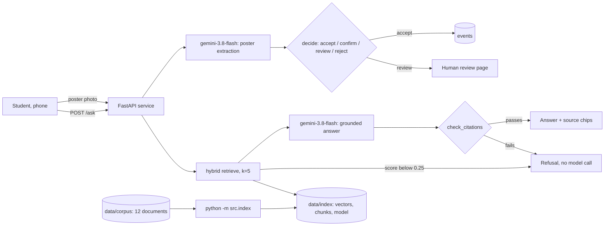

# Design Review · CampusPulse · reference team

*A filled example for the course's reference app. Your review is about your product, in your words. Notice the shape: short sections, tables, and a link behind every claim.*

Members: Instructor reference team · Repo: `Lab-4/examples/campuspulse-rag/` and the Week 2 and Week 3 examples · Graded commit: tag `design-review`

## 1 · Problem, users, success criteria

**Problem.** KIU students find out about events from posters in corridors, club chats and word of mouth. Rules that decide whether an event can happen (room booking, food, outside guests) live in documents few students read. Students miss events, and clubs break rules they did not know about.

**Users.** First- and second-year students checking what is on from a phone; club leads planning events. Full spec: `docs/spec.md` (Week 2, v1).

| # | Success criterion | Measured by | Today |
|---|---|---|---|
| S1 | Answers about clubs and rules cite the document they came from, or refuse | golden set g1 to g5, `evals/results/` | 4/5 offline; live run before submission |
| S2 | No invented answer reaches a student: a reply citing a source that was not retrieved is refused | `tests/test_answer.py`, 12 tests | passing |
| S3 | A poster photo becomes an event only when every required field is accepted; everything else goes to confirm or review | Week 3 `tests/`, routes in `docs/confidence-policy.md` | passing |
| S4 | Median cost per question under $0.005 and p95 latency under 4 s | `logs/usage.jsonl` | see section 5 |

## 2 · Architecture and data flow

| Model call | Model id | Input | Output | Validated by |
|---|---|---|---|---|
| embed | `openai/text-embedding-3-small` | chunks at ingest, the question at query time | 1,536 numbers, normalised | index refuses a mismatched model (`src/index.py`) |
| grounded answer | `google/gemini-3.8-flash` | prompt with 5 numbered sources | `{answer, citations, grounded}` | pydantic `Reply`, then `check_citations()` |
| poster extraction | `google/gemini-3.8-flash` | downscaled photo + schema | value, evidence, confidence per field | pydantic `Extraction`, then `decide()` |
| promo image | `google/gemini-3.1-flash-image` | text prompt | one image | human approves before posting |

The refusal arrow from retrieval is the cheapest safety feature we have: nothing is generated when nothing relevant was found. The human review page is where a person is in the loop for posters.

## 3 · Risks and safety threats

| Risk | What a user would see | Mitigation | Owner |
|---|---|---|---|
| A confident invented answer (a fee, a date) | wrong information, stated as fact | grounded answers with checked citations (`src/answer.py`); golden g1 checks the fee | spec keeper |
| A real citation attached to a wrong sentence | "costs 20 GEL [1]" with a real source | `must_mention` in the golden set catches known cases; Week 11 adds an LLM judge | eval keeper |
| A torn or misleading poster becomes an event | wrong time or room in the feed | Week 3 confidence routing; hard-flagged fields never prefilled (`docs/confidence-policy.md`) | repo keeper |
| Instructions hidden in a poster or document ("ignore your rules...") | the model follows the attacker | retrieved text is data, never instructions; planned defense and red-team test in Week 12 | spec keeper |
| Personal data in the corpus or test images | a student's name or face exposed | corpus is club pages and rules only; no faces in `tests/images/` (Lab 3 rule) | repo keeper |
| Provider outage or price change | `/ask` fails or costs double when the promotion ends | usage log shows cost per call; fallback chain planned in Week 10 | repo keeper |

## 4 · Evaluation plan

- Golden set: `evals/golden.yaml`, 5 questions (2 factual, 1 reasoning, 1 edge, 1 refusal), threshold 0.70.
- Last run: offline stand-ins, `evals/results/2026-10-13-2335-offline-k5.json`: 4/5 (0.80). The live run with the real models is committed before submission and its pass rate replaces this line.
- What failed and why: g3 ("snacks" in Lab B204) offline, because the stand-in embedder matches letters, not meaning, so the food rule ranks sixth and is not retrieved. We expect the live embedder to find it; if it does not, we raise k to 6 or add "snacks" handling to the policy page's header, and record the decision.
- By Week 11: 10 questions (add 1 factual, 1 reasoning, 1 edge, 1 refusal, 1 format), an LLM judge from a different model family for answers `must_mention` cannot check, and the run in CI blocking merges below 0.70.

## 5 · Token budget

| Feature | Model | Tokens in / out | Cost per request | Latency | Source |
|---|---|---|---|---|---|
| `/ask` | gemini-3.8-flash + embedding | about 1,650 / 150 | $0.0018 | to measure live | prompt size; median from `logs/usage.jsonl` after the live run |
| poster extraction | gemini-3.8-flash | 1,382 / 214 | $0.0018 | 2.9 s | Week 3 usage log line |
| index the corpus | text-embedding-3-small | 52 chunks, once | under $0.001 | seconds | ingest run |

Monthly at 300 students asking 3 questions a day and 20 posters a day: 27,000 questions × $0.0018 + 600 posters × $0.0018 ≈ **$50 a month**, doubling when the 50% promotion ends. Putting the corpus in every prompt instead would cost about 75 times more per question (`Lab-4/resources/rag-or-long-context.md`).

## 6 · Team, roles and decisions

- Team contract and roles: `TEAM-CONTRACT.md`, `docs/TEAM-REPO.md` section 1
- Decision records: `docs/decisions/0001-hybrid-retrieval.md` · `docs/decisions/0002-k-equals-5.md`
- Next: Week 5 turns room availability, add-to-calendar and RSVP into validated tools (the Tool Contract). The spec keeper drives the first tool slice.
